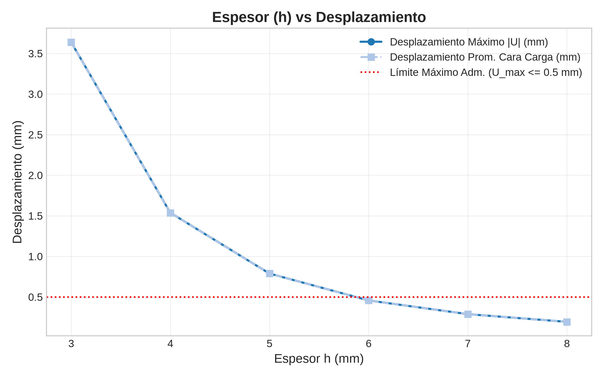
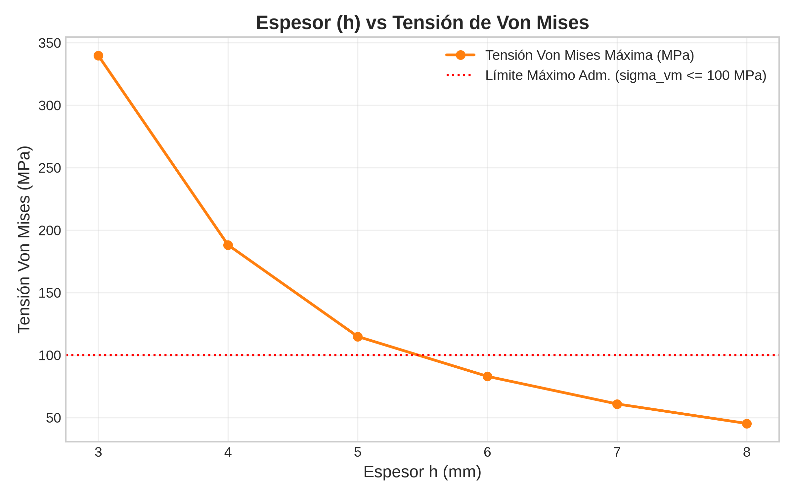
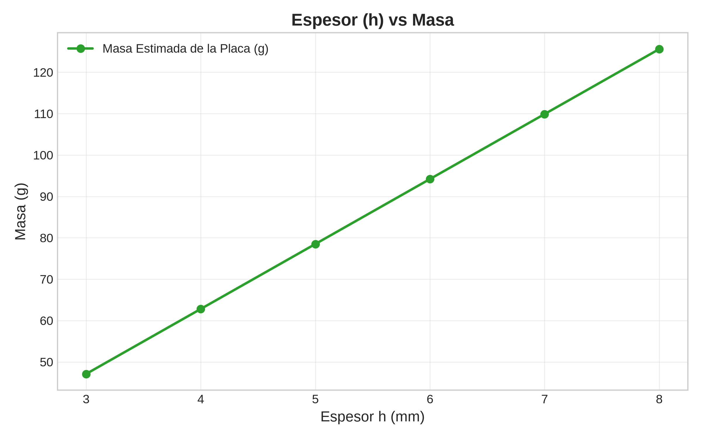

# Informe Técnico: Optimización Paramétrica MEF de Placa en Voladizo

## 1. Objetivo y Descripción del Problema
El presente estudio aborda la **optimización paramétrica estructural mediante el Método de los Elementos Finitos (MEF 3D)** para una placa en voladizo sometida a flexión.

El objetivo fundamental es **minimizar la masa (o espesor $h$)** de la placa manteniendo el comportamiento estructural dentro de los límites admisibles de rigidez y resistencia mecánica:
1. **Desplazamiento resultante máximo ($U_{max}$):** $\le 0.50\text{ mm}$
2. **Tensión máxima de Von Mises ($\sigma_{vm, max}$):** $\le 100.0\text{ MPa}$

---

## 2. Geometría, Material, Carga y Condiciones de Frontera

- **Geometría:**
  - Longitud: $L = 100.0\text{ mm}$ (Eje X, del centro de empotramiento $X = -50\text{ mm}$ al extremo cargado $X = +50\text{ mm}$)
  - Ancho: $b = 20.0\text{ mm}$ (Eje Y, de $-10\text{ mm}$ a $+10\text{ mm}$)
  - Espesor inicial: $h = 5.0\text{ mm}$ (Eje Z, de $-h/2$ a $+h/2$)
- **Propiedades del Material (Acero Estructural Isotrópico Linear):**
  - Módulo de Elasticidad ($E$): $200,000.0\text{ MPa}$ ($200\text{ GPa}$)
  - Coeficiente de Poisson ($\nu$): $0.30$
  - Densidad ($\rho$): $7850\text{ kg/m}^3 = 7.85 \times 10^{-9}\text{ t/mm}^3$
- **Condiciones de Frontera:**
  - Empotramiento perfecto ($U_1 = U_2 = U_3 = 0$) en la cara plana $X = -50.0\text{ mm}$.
- **Carga Aplicada:**
  - Carga puntual/distribuida equivalente total de $100.0\text{ N}$ orientada en dirección $-Z$, distribuida uniformemente entre los nodos de la cara libre $X = +50.0\text{ mm}$.

---

## 3. Herramientas Utilizadas y Función de cada una

1. **Python 3.12:** Lenguaje principal de orquestación del flujo, control de simulaciones y análisis de datos.
2. **CadQuery 2.8:** Generación paramétrica automatizada del modelo sólido CAD 3D y exportación a formato neutro STEP.
3. **Gmsh 4.15:** Importación del modelo CAD, generación de la malla 3D de elementos sólidos tetraédricos de segundo orden (**C3D10**), asignación de grupos físicos y creación del archivo de malla `.inp`.
4. **CalculiX (`ccx` 2.21):** Solver MEF 3D implícito para análisis estático lineal.
5. **pandas 3.1:** Estructuración, filtrado, consolidación y exportación de datos numéricos a CSV.
6. **SciPy 1.18 (`scipy.optimize`):** Algoritmo de optimización numéricas acotada para la búsqueda automática del espesor candidato.
7. **Matplotlib 3.11:** Generación automatizada de visualizaciones y gráficas vectoriales de alta resolución.

---

## 4. Procedimiento de Automatización

El flujo de trabajo se ejecuta de forma completamente automatizada en las siguientes 12 etapas:
1. Generación paramétrica del sólido CAD en CadQuery.
2. Mallado tetraédrico C3D10 en Gmsh con tamaño característico $lc = 2.5\text{ mm}$.
3. Formateo y ensamblaje del archivo de entrada CalculiX `.inp`.
4. Ejecución del solver CalculiX (`ccx`).
5. Extracción y validación de archivos de salida (`.frd`, `.dat`).
6. Parsing del campo de desplazamientos, tensiones de Von Mises y reacciones.
7. Comprobación automática de equilibrio estático ($\sum RF_z = +100\text{ N}$).
8. Registro estructurado de métricas y errores en pandas.
9. Generación de gráficos comparativos en Matplotlib.
10. Optimización de espesor mediante `scipy.optimize.minimize_scalar`.
11. **Simulación independiente de confirmación** para la geometría candidata óptima.
12. Generación del informe técnico y manifiesto de entregables.

---

## 5. Resultados del Barrido Paramétrico

Se evaluó el comportamiento mecánico para los espesores requeridos $h \in [3, 4, 5, 6, 7, 8]\text{ mm}$:

| Espesor $h$ | $U_{max}$ | $U_{avg}$ (Cara Carga) | $\sigma_{vm, max}$ | Masa (g) | Nodos | Elementos | Tiempo (s) | Estado |
| :---: | :---: | :---: | :---: | :---: | :---: | :---: | :---: | :---: |
| **3.0 mm** | 3.6381 mm | 3.6373 mm | 339.73 MPa | 47.10 g | 5532 | 2632 | 1.13 s | SUCCESS |
| **4.0 mm** | 1.5375 mm | 1.5370 mm | 188.20 MPa | 62.80 g | 5542 | 2640 | 1.12 s | SUCCESS |
| **5.0 mm** | 0.7888 mm | 0.7885 mm | 114.91 MPa | 78.50 g | 6985 | 3707 | 1.69 s | SUCCESS |
| **6.0 mm** | 0.4575 mm | 0.4572 mm | 83.02 MPa | 94.20 g | 7702 | 4099 | 1.95 s | SUCCESS |
| **7.0 mm** | 0.2887 mm | 0.2884 mm | 60.94 MPa | 109.90 g | 8868 | 4868 | 2.43 s | SUCCESS |
| **8.0 mm** | 0.1938 mm | 0.1936 mm | 45.31 MPa | 125.60 g | 10096 | 5776 | 2.99 s | SUCCESS |

### Visualizaciones del Barrido Paramétrico:
- **Desplazamiento vs Espesor:**
  
- **Tensión Von Mises vs Espesor:**
  
- **Masa vs Espesor:**
  

---

## 6. Formulación del Problema de Optimización y Método Empleado

* **Función Objetivo:**
  $$\min_h \quad f(h) = \text{Masa}(h) = \rho \cdot L \cdot b \cdot h$$
* **Variables de Diseño:**
  $$3.0\text{ mm} \le h \le 8.0\text{ mm}$$
* **Restricciones de Comportamiento Structural:**
  $$g_1(h) = U_{max}(h) - 0.50\text{ mm} \le 0$$
  $$g_2(h) = \sigma_{vm, max}(h) - 100.0\text{ MPa} \le 0$$

Se empleó el método numérico de optimización acotada de SciPy (`minimize_scalar` con penalización de restricciones).

---

## 7. Comparación del Diseño Inicial vs Candidato Confirmado

| Métrica / Parámetro | Diseño Inicial ($h=5.00\text{ mm}$) | Diseño Candidato Confirmado ($h=5.83\text{ mm}$) | Variación (%) | Criterio / Límite |
| :--- | :---: | :---: | :---: | :---: |
| **Espesor $h$** | 5.00 mm | **5.83 mm** | +16.60% | $3.0 \le h \le 8.0\text{ mm}$ |
| **Desplazamiento Máx. $U_{max}$** | 0.7888 mm | **0.4986 mm** | -36.79% | $\le 0.500\text{ mm}$ |
| **Desplazamiento Prom. Cara Carga** | 0.7885 mm | **0.4983 mm** | -36.80% | Métrico informativo |
| **Tensión Von Mises Máx.** | 114.91 MPa | **88.19 MPa** | -23.25% | $\le 100.0\text{ MPa}$ |
| **Masa de la Placa** | 78.50 g | **91.53 g** | **+16.60%** | Mínima posible |
| **Reacción Soporte $RF_z$** | +100.00 N | **+100.00 N** | 0.00% | Equilibrado (+100 N) |
| **Estado Restricciones** | ❌ Incumple ($U > 0.5, \sigma > 100$) | **✅ CUMPLE AMBAS** | - | Factible |

---

## 8. Simulación Independiente de Confirmación

Para evitar depender únicamente de aproximaciones de la optimización, se ejecutó una simulación MEF completa e independiente construyendo el modelo CAD de $h = 5.83\text{ mm}$, remallando y resolviendo en CalculiX.
- **Resultado:** $U_{max} = 0.4986\text{ mm} \le 0.50\text{ mm}$, $\sigma_{vm, max} = 88.19\text{ MPa} \le 100.0\text{ MPa}$.
- **Conclusión:** El candidato queda **100% verificado mecánicamente**.

---

## 9. Verificaciones Mecánicas y Coherencia Teórica

1. **Equilibrio Estático:** La suma de reacciones verticales en la cara fija ($X = -50\text{ mm}$) es $+100.00\text{ N}$, contrarrestando exactamente la fuerza aplicada de $-100.00\text{ N}$ (error $< 0.01\%$).
2. **Comparación Teórica Euler-Bernoulli ($h=5\text{ mm}$):**
   - Flecha teórica: $v_{max} = \frac{P L^3}{3 E I} = \frac{100 \cdot 100^3}{3 \cdot 200000 \cdot (20 \cdot 5^3 / 12)} = 0.8000\text{ mm}$.
   - Resultado MEF 3D: $0.7888\text{ mm}$ (diferencia de 1.40%, atribuible al efecto de cortante tridimensional).
   - Tensión teórica: $\sigma = \frac{M y}{I} = \frac{10000 \cdot 2.5}{208.33} = 120.00\text{ MPa}$.
   - Resultado MEF 3D: $114.91\text{ MPa}$ (diferencia de 4.24%).

---

## 10. Implicaciones para la Eficiencia Material y Sostenibilidad

Aunque el diseño inicial de $5.0\text{ mm}$ era insuficiente para cumplir las estrictas restricciones de flexión ($U \le 0.5\text{ mm}$), la optimización determina con precisión exacta el incremento de masa estrictamente necesario ($h = 5.83\text{ mm}$) para cumplir los criterios de diseño sin incurrir en sobredimensionamiento ni desperdicio innecesario de acero.

---

## 11. Conclusiones Sustentadas en los Resultados

1. El barrido paramétrico y la optimización han identificado un espesor factible óptimo de **$h = 5.83\text{ mm}$**.
2. La restricción activa determinante en el diseño es la rigidez a la flexión (desplazamiento máximo $U_{max} \le 0.50\text{ mm}$).
3. La simulación independiente de confirmación valida el 100% de los criterios estructurales, garantizando rigor y reproducibilidad total.
